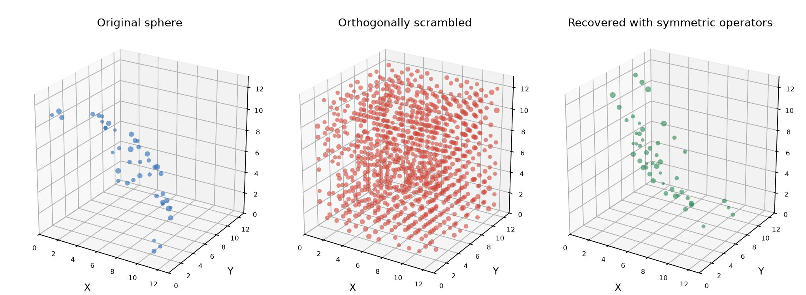
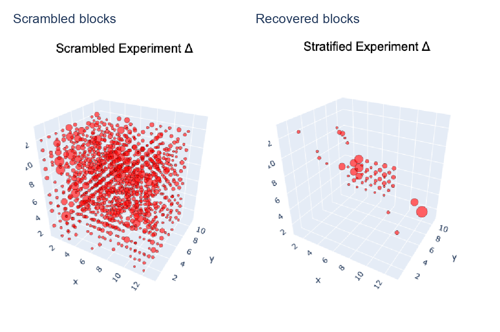
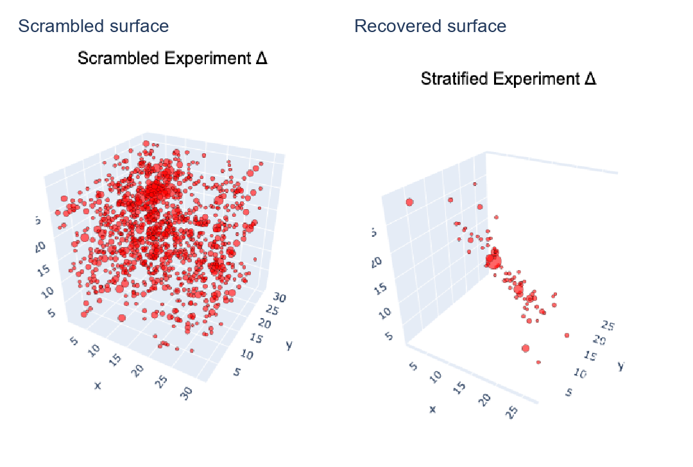
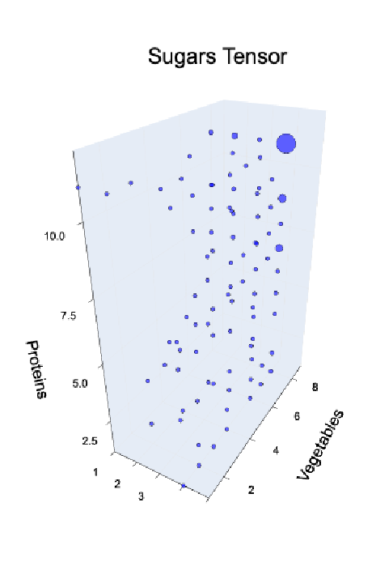

# OpenDleto

OpenDleto finds hidden structure in tensor data by changing coordinates to reveal block patterns, lower dimensional support, and continuous structure. *Dleto* means “chisel”: the choice of chisel guides the structure to look for. See [TheTensor.Space](https://TheTensor.Space/) for the larger project.


| [What?](#what-opendleto-finds) | [Who?](#contributors) | [Online](#try-the-python-notebook) | [Julia](#use-the-julia-package) | [Python](#try-the-python-notebook) | [Contribute](#contributors) |
| --- | --- | --- | --- | --- | --- |

## What OpenDleto finds

[](https://mybinder.org/v2/gh/thetensor-space/OpenDleto/main?urlpath=lab/tree/labs)

Binder opens the `labs` folder in JupyterLab. Choose a notebook there, or open `python` for the Python labs.

The [Sphere Lab](labs/SphereLab.ipynb) starts with points on a sphere, hides them with an orthogonal coordinate change, then uses a symmetric-operator chisel to recover the surface structure:



The [Chiseling 101 lab](labs/Chiseling101.ipynb) also hides block structure with a coordinate change and then recovers a sparse pattern:



The same lab recovers a hidden surface pattern after stratification:



The [What We Eat in America lab](labs/WhatWeEatInAmerica.ipynb) applies these tools to nutrition data. Its sugars tensor records added sugar against food categories:



## Try the Python notebook

[](https://mybinder.org/v2/gh/thetensor-space/OpenDleto/main?urlpath=lab/tree/labs/python)

The [Python Sphere Lab](labs/python/SphereLab.ipynb) explores ordinary and densor sphere tensors, including recovery with a symmetric-operator chisel.

The [Python What We Eat in America lab](labs/python/WhatWeEatInAmerica.ipynb) builds the same 4 × 8 × 11 sugar tensor as the Julia lab and compares Tucker reduction, HOSVD, a rank-five CP approximation, and Python derivation diagnostics. The Python and Julia stratification results may differ.

The [Python Chiseling 101 lab](labs/python/Chiseling101.ipynb) follows the Julia lab's three experiments with interactive 3D plots. Its large surface experiment uses a partial derivation solve; the notebook reports whether each derivation count is exact.

The [Python recovery notebook](python/examples/recovery.ipynb) builds a tensor with hidden diagonal support, recovers a structural mask, and compares it with a random tensor. The Binder environment also provides the Dleto Julia kernel and installs `opendleto` from this checkout before Jupyter starts. Binder may take a few minutes to build the environment on its first launch.

To run the Python Chiseling 101 lab locally, use Python 3.10 or newer from a repository checkout:

```sh
python -m pip install -e './python[lab]'
python -m pip install jupyterlab
python -m jupyter lab labs/python/Chiseling101.ipynb
```

## Use the Julia package

Install [Julia 1.12 or newer](https://julialang.org/downloads/), clone this repository, and run these commands from its root:

```sh
julia --project=. -e 'using Pkg; Pkg.instantiate()'
julia --project=. -e 'using Dleto; println("Dleto loaded")'
```

Start an interactive session with `julia --project=.` and enter `using Dleto`. For use from another Julia environment, add the repository URL:

```julia
using Pkg
Pkg.add(url="https://github.com/thetensor-space/OpenDleto.git")
using Dleto
```

For local development, `Pkg.develop(path="/path/to/OpenDleto")` makes another Julia environment use your checkout. Run the package tests from the repository root with:

```sh
julia --project=. -e 'using Pkg; Pkg.test()'
```

The same test command runs in [Julia CI](.github/workflows/julia.yml) when Julia package or test files change in pushes and pull requests. The package definition is [Project.toml](Project.toml), its source is in [`src/`](src/), and tests are in [`test/`](test/). Julia's package manager installs the required dependencies; `Arpack` and `Metal` are optional extensions.

The Julia notebooks use a Julia kernel and the full Julia package. To run them locally, install Jupyter and launch it from the repository root after instantiating the Julia project:

```sh
julia --project=. -e 'using IJulia; IJulia.installkernel("Dleto", "--project=$(pwd())")'
julia --project=. -e 'using IJulia; IJulia.notebook(dir=pwd())'
```

Select the **Dleto** kernel when opening a notebook. Some notebooks download data or generate figures and may need additional time or resources.

| Julia notebook | What it demonstrates |
| --- | --- |
| [Chiseling 101](labs/Chiseling101.ipynb) | Chisels, block decompositions, and stratification; [exported PDF](labs/Chiseling101.pdf) |
| [Sphere Lab](labs/SphereLab.ipynb) | Recovering hidden surface structure in a point cloud |
| [What We Eat in America](labs/WhatWeEatInAmerica.ipynb) | Finding structure in nutrition data; [exported PDF](labs/WhatWeEatInAmerica.pdf) |

### Julia BLAS backend

On macOS 13.4 or later, loading `Dleto` forwards BLAS and LAPACK operations to Apple's Accelerate framework when its ILP64 interface is available. Linux, Windows, and unsupported Macs normally retain Julia's OpenBLAS. Set `DLETO_BLAS=openblas` before loading `Dleto` to keep the current backend; inspect it with `Dleto.blas_backend()`.

## Contributors

We welcome contributions and questions through GitHub issues and pull requests.

| Portrait | Contributor | Affiliation during this work | Website / GitHub |
| --- | --- | --- | --- |
|  | Peter A. Brooksbank | [Bucknell University](https://www.bucknell.edu/fac-staff/peter-brooksbank) | [Website](https://brooksbankpa.github.io/) · [@brooksbankpa](https://github.com/brooksbankpa) |
|  | Martin Kassabov | [Cornell University](https://math.cornell.edu/martin-kassabov) | [Profile](https://math.cornell.edu/martin-kassabov) · [@kassabov](https://github.com/kassabov) |
|  | Joshua Maglione | [University of Galway](https://research.universityofgalway.ie/en/persons/joshua-maglione/) | [Website](https://joshmaglione.com/) · [@joshmaglione](https://github.com/joshmaglione) |
|  | Amaury V. Miniño | [Colorado State University](https://mathematics.colostate.edu/) | [@amaury-minino](https://github.com/amaury-minino) |
|  | Chris Liu | [Colorado State University](https://mathematics.colostate.edu/) | [Website](https://chris-cl587.github.io/) · [@cliu587](https://github.com/cliu587) |
|  | James B. Wilson | [Colorado State University](https://newsmediarelations.colostate.edu/contacts/james-wilson/) | [Profile](https://newsmediarelations.colostate.edu/contacts/james-wilson/) · [@algeboy](https://github.com/algeboy) |

## Packages
The **Julia package `Dleto` is the primary, supported implementation**. The **Python package `opendleto` is an experimental, AI-assisted clone** of selected tools. It is useful for a quick browser demo and Python experiments, but it does not yet reproduce the full Julia API or all of its numerical behavior.

| | Julia `Dleto` | Python `opendleto` |
| --- | --- | --- |
| Role | Main implementation and reference for the algorithms | AI-assisted, partial clone |
| Coverage | Full package and the Julia lab notebooks | Selected chisels, derivations, and stratification; [coverage and differences](docs/python.md#feature-coverage) |
| Setup | Julia 1.12+; [installation and tests](#use-the-julia-package) | Python 3.10+, NumPy, SciPy; no Julia runtime; [launch on Binder](#try-the-python-notebook) |

## Publications

Peter A. Brooksbank, Martin D. Kassabov, and James B. Wilson, **“Detecting null patterns in tensor data.”** [SIAM publication](https://doi.org/10.1137/25M1766930) · [Open preprint](https://arxiv.org/abs/2408.17425).

If you use OpenDleto in research, please cite this paper.

## Acknowledgments

* [Star algebras and adjoints](https://github.com/thetensor-space/StarAlge) — Peter A. Brooksbank and James B. Wilson.
* [TensorSpace categories and data types](https://github.com/thetensor-space/TensorSpace) — Joshua Maglione and James B. Wilson.
* [Fast derivation solvers](https://github.com/cliu587/fast-der-solver) — Chris Liu's reference solve-and-lift code for `FastDer3Valent` and the Liu–Maglione–Wilson `QuickSylver` work.
* [Hypergraph tensors](https://github.com/thetensor-space/Hypergraphs) — Amaury Miniño, James B. Wilson, Clara Chaplin, and Peter A. Brooksbank.
* [Lab data sets](labs/) — Gavin Moore.

Other related repositories: [Sylver](https://github.com/thetensor-space/Sylver), [MatrixAlgebras](https://github.com/thetensor-space/MatrixAlgebras), [Homotopism](https://github.com/thetensor-space/Homotopism), and [Tenscenery](https://github.com/thetensor-space/Tenscenery).

Research support:

| Logo | Organization | Support |
| --- | --- | --- |
|  | US National Science Foundation | DMS-1620454 |
|  | Simons Foundation | 281435 and 636189 |
|  | US National Security Agency, Math Sciences Program | H98230-11-1-0146 and H98230-19-1-00 |

Host institutions:

| Logo | Institution |
| --- | --- |
|  | Colorado State University |
|  | Kent State University |
|  | University of Auckland |
|  | Bucknell University |
|  | Bielefeld University |
|  | Hausdorff Institute |
|  | Isaac Newton Institute |

[Logo sources](docs/images/logos/README.md)

OpenDleto is released under the [MIT License](LICENSE).
